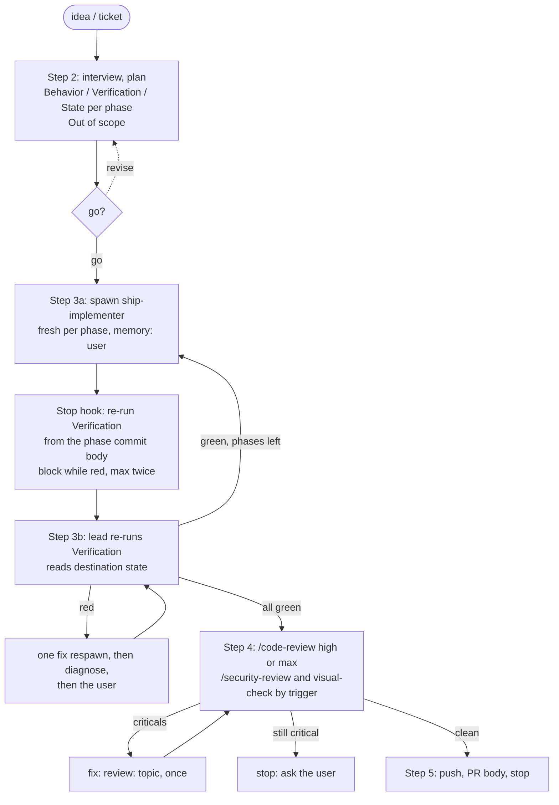

# ship: architecture (v3)

One skill (the lead) and one agent (the implementer). Three mechanisms carry the state and the discipline; the platform carries the rest.

## Flow

## The three mechanisms

**1. The contract travels in the commit body.** Every phase lands as one commit, subject `phase <N>: <title>`, body `Behavior: / Verification: / State:`. The lead, a resumed run and the Stop hook all read it back with `git show`. Fix commits are forward-only (`fix: phase <N> verifier: …`, `fix: review: …`); nothing is amended or rebased, so the history is the audit trail and `git log <base>..HEAD` is the resume state. No files are written outside git.

**2. The Stop hook is the verifier.** `hooks/verify-phase.sh` runs when the implementer tries to finish: it takes the `Verification:` line from the newest commit of the run (`<base>..HEAD`, the base recorded by the lead in `git config ship.baseRef`) that carries one, the `phase <N>:` commit or a forward-only fix commit restating it, runs it in the working tree, and exits 2 with the output while the line is missing, the tree is dirty or the command is red. Two blocks per agent in total, then it lets the agent through so the lead can decide. A final message starting with `BLOCKER:` passes untouched. One line per run goes to `.git/ship-verify.log`, so the lead can confirm the hook fired. Deterministic, zero tokens, no delivery step: the v2 haiku verifier, its JSON rubric, the livelock detector and the "send your verdict" protocol are all replaced by one shell script.

**3. Memory is the platform's.** `memory: user` on the agent gives it `~/.claude/agent-memory/ship-implementer/MEMORY.md`, loaded into every spawn (first 200 lines). The agent appends two-line, stack-agnostic entries itself. `memory/MEMORY.seed.md` carries 45 runs of v2 lessons distilled; `install.sh` seeds it once. The v2 retro agent, seven role files, caps, pruning, provenance tags, `lessonConflicts` and expiry are gone.

## What the lead does and does not delegate

| Step | Who | Why |
|---|---|---|
| Interview and plan | lead | needs the user in the loop |
| Implement a phase | `ship-implementer` | fresh context per phase; the lead stays out of the tree |
| Verify a phase | hook, then lead | the hook blocks the obvious red; the lead reads destination state |
| Debug a stuck phase | lead, via the `diagnose` skill | one disciplined pass before asking the user |
| Code review | `/code-review` | the built-in at high or max found what the v2 sonnet panel missed |
| Security, visual | `/security-review`, `visual-check` | triggered by diff patterns and plan keywords |
| Push, PR body | lead | template detection and the evidence body are ship-specific |

## Shared tree, one writer

The implementer works in the lead's checkout. The rule that replaces v2's ownership protocol: the lead touches nothing (no edits, no staging, no tests) while an implementer runs, and the implementer never reverts a path it did not modify. Both v2 work-loss incidents were violations of exactly this. Worktree isolation per phase is available (`isolation: worktree` on the agent, `worktree.baseRef: "head"` in the target repo), at the cost of a dependency install per phase.

## Hard rules

- One gate: `go` after the plan. Then autonomous until a red the lead cannot clear or a `BLOCKER:`.
- One commit per phase, triplet in the body. Fix commits forward-only. Never amend, rebase, force-push.
- The lead gates every phase itself; the hook and the implementer's report are inputs.
- Never modify or push the base branch. Never auto-merge. Never delete the branch.
- Refuted premises and review findings go into the PR body.

## What ship does not do

- Manage worktrees, dev servers or dependencies.
- Persist state outside git.
- Merge.
- Write to the target repo's docs or `CLAUDE.md`.
