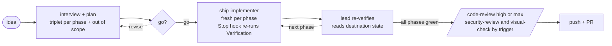

# ship

`/ship <prompt>` for [Claude Code](https://docs.anthropic.com/claude/claude-code): a feature idea (ticket URL, issue link or freeform text) to a reviewed pull request, as a fixed discipline rather than an agent team.

v3 is one skill plus one agent. Everything v2 hand-rolled (a verifier agent, a four-reviewer panel, a debugger, a retro agent with seven lessons files, JSON return contracts and a delivery protocol) is now either a Claude Code native (subagent memory, Stop hooks, `/code-review` with effort levels) or was measured as not earning its tokens. The numbers are in [`CHANGELOG.md`](CHANGELOG.md) under 3.0.0.

## What stays

1. **A plan with a contract per phase and one human gate.** Every phase has Behavior / Verification (an executable command) / State, plus an explicit Out-of-scope list. The user says `go` once.
2. **One `phase N:` commit per phase, contract in the commit body.** Resume after an interruption is `git log`; nothing is written to disk.
3. **A fresh implementer per phase** (`ship-implementer`, opus) with `memory: user`, so stack-agnostic lessons carry across runs natively. It must report which premises of its brief it refuted: measured at 7 refutations in 7 phases, two of which prevented shipped regressions.
4. **The lead gates every phase itself.** A Stop hook on the implementer re-runs the phase's Verification command and blocks it while red; the lead re-runs it anyway and reads destination state, not exit codes.
5. **Review by the built-ins.** `/code-review` at high or max, `/security-review` on auth, payment and schema triggers, `visual-check` on UI diffs when a dev server is up.

## Flow



## Install

Requires Claude Code, git, `jq` (the Stop hook parses its input with it), and optionally `gh`.

```bash
git clone https://github.com/aliaksei-loi/ship.git ~/Documents/hobby/ship
cd ~/Documents/hobby/ship && ./install.sh
```

`install.sh` symlinks the skill, the agent and the hook into `~/.claude/`, removes v1 and v2 agent symlinks, and seeds the implementer's memory at `~/.claude/agent-memory/ship-implementer/MEMORY.md` when that file is empty. Restart Claude Code afterwards.

## Usage

```
/ship <prompt>                 # ticket URL, issue URL, or freeform
/ship                          # asks what to ship
/ship base:<branch> <prompt>   # pin the PR base branch for this run
```

Merge is never automatic. Ask for it afterwards.

## Opt-in: a worktree per phase

Add `isolation: worktree` to the frontmatter of `agents/ship-implementer.md` to run each phase in its own git worktree. Two costs come with it: set `worktree.baseRef` to `"head"` in the target repo's `.claude/settings.local.json` (otherwise the phase branches from the default branch rather than from the previous phase), and each worktree needs its own dependency install. The default shared tree relies on one rule instead: the lead touches nothing while the implementer runs.

## Structure

```
ship/
├── skills/ship/SKILL.md        # the lead
├── agents/ship-implementer.md  # the one agent (memory: user, Stop hook)
├── hooks/verify-phase.sh       # Stop hook: re-runs the Verification line from the phase commit
├── memory/MEMORY.seed.md       # stack-agnostic lessons from 45 v2 runs; seeds the agent memory
├── ARCHITECTURE.md
├── CHANGELOG.md
└── install.sh
```

## License

MIT. See [LICENSE](LICENSE).
